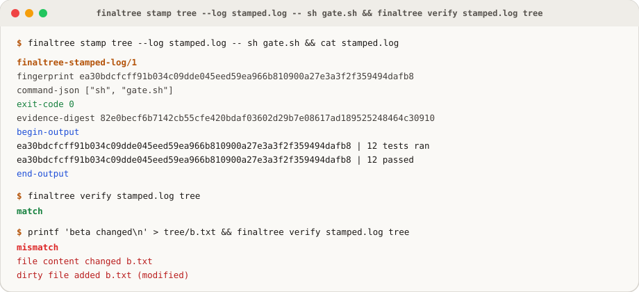
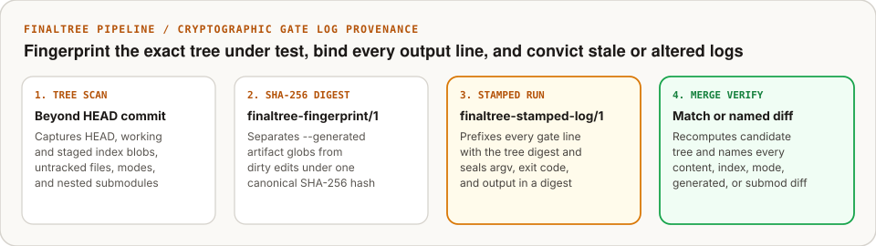
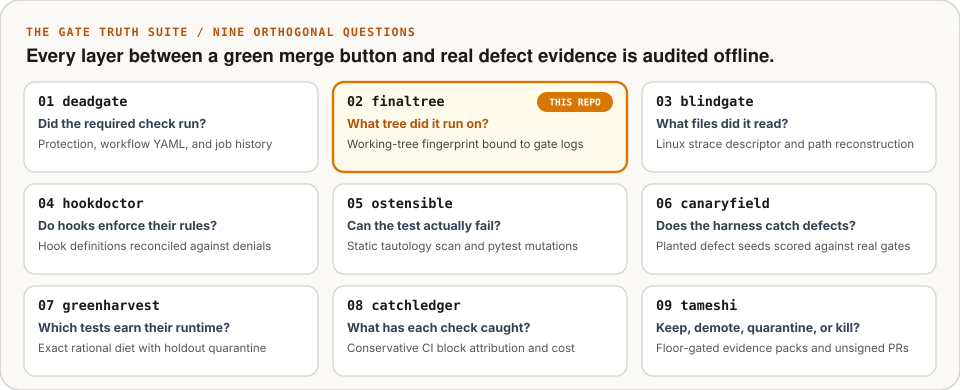

<p align="center">
  <a href="https://github.com/david-engelmann/finaltree">
    <picture>
      <source media="(prefers-color-scheme: dark)" srcset="https://raw.githubusercontent.com/david-engelmann/finaltree/main/docs/media/finaltree-lockup-dark.svg">
      
    </picture>
  </a>
</p>

<p align="center">
  <a href="https://github.com/david-engelmann/finaltree/blob/main/docs/GUIDE.md"><b>Operator Guide</b></a> |
  <a href="https://david-engelmann.github.io/finaltree/">Published Docs</a> |
  <a href="https://github.com/david-engelmann/finaltree/tree/main/examples">Examples</a> |
  <a href="https://github.com/david-engelmann/finaltree/blob/main/docs/ARCHITECTURE.md">Architecture</a> |
  <a href="https://github.com/david-engelmann/finaltree/blob/main/docs/FORMATS.md">Wire Formats</a> |
  <a href="https://github.com/david-engelmann/finaltree/blob/main/docs/COMPARISON.md">Comparison</a> |
  <a href="https://github.com/david-engelmann/finaltree/blob/main/docs/FAQ.md">FAQ</a> |
  <a href="https://github.com/david-engelmann/finaltree/releases">Releases</a>
</p>

<p align="center">
  <a href="https://github.com/david-engelmann/finaltree/actions/workflows/ci.yml"></a>
  <a href="https://david-engelmann.github.io/finaltree/"></a>
  <a href="https://github.com/david-engelmann/finaltree/blob/main/Cargo.toml"></a>
  <a href="https://github.com/david-engelmann/finaltree/blob/main/LICENSE"></a>
</p>

# finaltree

Provenance for gate results, fingerprinting the exact tree under test, commit, dirty files, and generated artifacts, binding that fingerprint to every log line and count the gate reports, and verifying it matches the merge candidate before anyone says verified.

<p align="center">
  <picture>
    <source media="(prefers-color-scheme: dark)" srcset="https://raw.githubusercontent.com/david-engelmann/finaltree/main/docs/media/terminal-showcase-dark.svg">
    
  </picture>
</p>

## What this is

Gate results get quoted from logs inherited from a superseded tree, and counts get reported from builds that never included the final commit, a failure careful teams currently defend against by checking log provenance by hand. Finaltree makes that rule a tool. It fingerprints the exact tree a gate ran on and binds the fingerprint to everything the gate reports, so a verdict can always be traced to the code it was measured on. The boundary with its siblings is one sentence. Finaltree asks what it ran on, where deadgate asks whether it ran and blindgate asks what it read.

<p align="center">
  <picture>
    <source media="(prefers-color-scheme: dark)" srcset="https://raw.githubusercontent.com/david-engelmann/finaltree/main/docs/media/how-it-works-dark.svg">
    
  </picture>
</p>

## Install

Install from source with Cargo (Rust `1.80` or newer with `git` on `PATH` on Linux and macOS) or install verified prebuilt archives via `install.sh` or `cargo-binstall` once release archives are attached (`v0.21.0` and `v0.22.0` onward).

```sh
cargo install --git https://github.com/david-engelmann/finaltree --locked
```

```sh
curl -fsSL https://raw.githubusercontent.com/david-engelmann/finaltree/main/install.sh | sh
export PATH="$HOME/.local/bin:$PATH"
cargo binstall --git https://github.com/david-engelmann/finaltree finaltree
```

## Quickstart

Stamp a gate command against a working tree (placing `--log` and any scratch build directory outside `ROOT` and passing `--` before the gate command), then verify the stamped log against the merge candidate.

```sh
CARGO_TARGET_DIR=/tmp/gate-target finaltree stamp . --log /tmp/gate.stamped.log -- cargo test --locked
finaltree verify /tmp/gate.stamped.log .
grep -qx 'exit-code 0' /tmp/gate.stamped.log
```

```text
finaltree-stamped-log/1
fingerprint ea30bdcfcff91b034c09dde045eed59ea966b810900a27e3a3f2f359494dafb8
fingerprint-json {"commit": "43984758cf79f17bdfbb4c1e11011c60f418cdd6", "digest": "ea30bdcfcff91b034c09dde045eed59ea966b810900a27e3a3f2f359494dafb8", ...}
command-json ["sh", "gate.sh"]
exit-code 0
evidence-digest 82e0becf6b7142cb55cfe420bdaf03602d29b7e08617ad189525248464c30910
begin-output
ea30bdcfcff91b034c09dde045eed59ea966b810900a27e3a3f2f359494dafb8 | 12 tests ran
ea30bdcfcff91b034c09dde045eed59ea966b810900a27e3a3f2f359494dafb8 | 12 passed
end-output
```

If any tracked file, staged index entry, untracked file, executable or symlink mode, declared `--generated` artifact, or submodule changes after stamping, `finaltree verify` exits `1` with `mismatch` and names every differing member.

## Examples

The examples folder holds two worked examples with their inputs and captured outputs. One fingerprints a small tree holding a modified file, a staged file, an untracked file, and a generated artifact. The other stamps a gate run on a clean tree and verifies the stamped log against the tree unchanged and changed.

## Verification and Footprint

Run the full local gate on Linux (and package/lint checks on Linux or macOS).

```sh
cargo test --locked
cargo fmt --check
cargo clippy --offline --all-targets
cargo package --locked
```

| Property | Value |
| --- | --- |
| External crate dependencies | `0` (`std` only, local `git`) |
| Minimum Supported Rust Version | `1.80` |
| Release binary size (`aarch64-apple-darwin`) | `1,122.5 KiB` |
| Digest algorithm | Canonical SHA-256 (`fingerprint` + `evidence-digest`) |
| Network calls | `0` |

## The Gate Truth Suite

<p align="center">
  <picture>
    <source media="(prefers-color-scheme: dark)" srcset="https://raw.githubusercontent.com/david-engelmann/finaltree/main/docs/media/gate-truth-arc-dark.svg">
    
  </picture>
</p>

| Tool | Question answered | Primary evidence |
| --- | --- | --- |
| [deadgate](https://github.com/david-engelmann/deadgate) | Did the required check actually run? | Branch protection, workflow YAML, and job history |
| [finaltree](https://github.com/david-engelmann/finaltree) | What exact tree did the gate run on? | Working-tree SHA-256 fingerprint bound to stamped logs |
| [blindgate](https://github.com/david-engelmann/blindgate) | What files did the gate actually read? | Linux `strace` descriptor and path reconstruction |
| [hookdoctor](https://github.com/david-engelmann/hookdoctor) | Do hooks enforce their declared rules? | Hook definitions reconciled against execution denials |
| [ostensible](https://github.com/david-engelmann/ostensible) | Can the test actually fail? | Static tautology scan and `pytest` mutations |
| [canaryfield](https://github.com/david-engelmann/canaryfield) | Does the harness catch planted defects? | Seeded defect classes scored across real gates |
| [greenharvest](https://github.com/david-engelmann/greenharvest) | Which tests earn their CI runtime? | Exact rational value ranking and reversible quarantine |
| [catchledger](https://github.com/david-engelmann/catchledger) | What has each check caught, and at what cost? | Conservative post-block Git DAG attribution and USD cost |
| [tameshi](https://github.com/david-engelmann/tameshi) | Keep, demote, quarantine, or kill this check? | 30-defect and 14-day floor-gated unsigned ruling PRs |

## Documentation

| If you want to... | Read |
| --- | --- |
| Browse the searchable handbook with diagrams | [Published documentation](https://david-engelmann.github.io/finaltree/) |
| Stamp CI runs, place `--log` and build outputs safely, and wrap Git hooks | [Operator Guide](https://github.com/david-engelmann/finaltree/blob/main/docs/GUIDE.md) |
| Understand multi-surface tree hashing and token-safe globs | [Architecture](https://github.com/david-engelmann/finaltree/blob/main/docs/ARCHITECTURE.md) |
| Integrate `finaltree-fingerprint/1` and `finaltree-stamped-log/1` | [Wire Formats](https://github.com/david-engelmann/finaltree/blob/main/docs/FORMATS.md) |
| Compare `finaltree` against `git rev-parse HEAD` and hermetic builders | [Comparison](https://github.com/david-engelmann/finaltree/blob/main/docs/COMPARISON.md) and [FAQ](https://github.com/david-engelmann/finaltree/blob/main/docs/FAQ.md) |
| Review threat boundaries, vulnerability reporting, and contribution gates | [Security Policy](https://github.com/david-engelmann/finaltree/blob/main/SECURITY.md) and [Contributing](https://github.com/david-engelmann/finaltree/blob/main/CONTRIBUTING.md) |

## Status

- Closed rounds stand at 23 of 100
- Slice 1 is the seed concept and stands as the concept this repo was created with
- Slice 2 is built and proven on synthetic fixture repos only
- Slice 2 computes a fingerprint of a working tree holding the HEAD commit, the tracked files with the git blob hash of their working tree content and of the content staged for them in the index, the untracked files with the git blob hash of their content, the dirty files named as staged or modified or untracked or conflicted, and the generated artifacts matching declared patterns, all under one SHA-256 digest over a canonical serialization, with the members retained beside the digest
- Slice 2 runs a gate command and writes a stamped log whose header carries the fingerprint and an evidence digest over the command and the exit code and the output as written, and whose every output line is prefixed with the fingerprint digest
- Slice 2 verifies a stamped log against a candidate tree and answers match or mismatch, naming every member that differs, with a generated artifact difference named as generated and never as an ordinary change, a difference in staged content named as an index difference, and a difference in untracked content named as an untracked difference
- Slice 3 binds the state of every submodule into the fingerprint, the commit the index records for its gitlink, the commit its checkout stands at, and the digest of its own fingerprint, so a submodule standing edited or staged or moved or uninitialized no longer reads as the submodule standing clean, and verify names a submodule difference as its own kind
- Slice 4 binds the mode of every untracked and generated file whose mode is not the plain standing into the fingerprint, an executable file standing at 100755 and a symbolic link standing at 120000 in a modes member that stands only where such a file stands, so a gate whose helper stood executable no longer stamps the same tree as a gate whose helper stood plain, and verify names a mode difference as a file mode difference
- The Round 1 review fixes are recorded in the contract and bind the index and the untracked content into the fingerprint, cover the stamped log with its evidence digest, and refuse any stamped log that arrives short of one of its claims
- Ignored files that match no declared generated pattern stand outside the fingerprint entirely, and a stamped log belongs outside the tree it stamps, because a log written into the tree it stamps would change the tree it names
- Slice 2 is the Round 1 work increment and is built on a local branch, and the round closes only after audit and two-axis review and red team and owner approval
- Round 2 is the first Rust port slice and is built on a local branch, carrying the fingerprint reading and the record and the stamped log and stamping and verification in a Rust crate proven against recordings taken from the landed Python, and its review fix pass is built on the same branch answering the red team and the two axis review in full with the conformance census asserted in every section, and the round closes only after audit and two-axis review and red team and owner approval
- Round 3 is the closing slice of the port and is built on a local branch, rebuilding the command line as the Python's own in the binary with its three doors and its argument model whole and retiring the Python, and its review fix pass answers the three reviews in full, carrying the generated patterns in tokens so a pattern byte can never stand for a character standing in a path, and the round closes only after audit and two-axis review and red team and owner approval
- AGENTS.md stands in this repo, the canonical template of the program with this repo's annex below its marked line
- Part of the impatient programming portfolio, in the Gate Truth arc

## Licence

MIT. See LICENSE.
