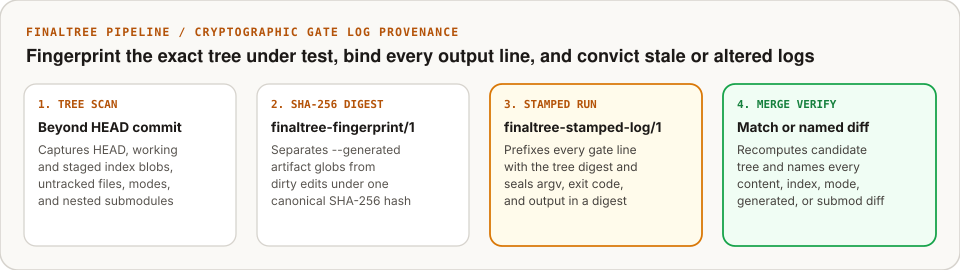

# Finaltree Architecture

Finaltree asks what exact working tree a gate ran on and binds that cryptographic identity to every line of output the gate emits. Implemented as a zero-dependency pure-Rust library (`src/lib.rs`) and CLI (`src/main.rs`) invoking local `git` plumbing with zero network calls, Finaltree closes the provenance gap between local or CI gate execution and merge-candidate verification.

  <picture>
    <source media="(prefers-color-scheme: dark)" srcset="https://raw.githubusercontent.com/david-engelmann/finaltree/main/docs/media/how-it-works-dark.svg">
    
  </picture>

## Pipeline Stages

### 1. Multi-Surface Working-Tree Scanner (`src/fingerprint.rs`)

Unlike `git rev-parse HEAD`, which sees only committed history, Finaltree captures every surface inside `ROOT` that can influence gate execution

- **`HEAD` commit** Resolved locally as a 40-hex commit hash (root repositories on an unborn branch with no `HEAD` commit are refused).
- **Tracked working-tree and index blobs** Both the working-tree content hash (`blob`) and every index stage hash (`index_blobs`), catching partially staged edits and merge conflicts.
- **Untracked files, ignored files, and `--generated` artifacts** Untracked files are partitioned by token-level glob patterns (`src/glob.rs`) into declared `generated` artifacts versus ordinary `untracked` files, and `.gitignore`-ignored files inside `ROOT` are bound under `ignored`.
- **File modes and special entries** Executable (`100755`) and symbolic-link (`120000`) modes on untracked, generated, and ignored files are bound in `modes`, and unreadable or special filesystem entries are classified deterministically.
- **Recursive submodules** Every submodule's index gitlink commit, checked-out `HEAD`, and recursive `finaltree` fingerprint digest are bound in `submodules`.

### 2. Token-Safe Glob Matcher (`src/glob.rs`)

Generated artifact patterns (`--generated PATTERN`) are decoded into an explicit character-and-raw-byte token alphabet rather than private-use Unicode sentinels, so genuine private-use Unicode codepoints in filenames never collide with raw OS argument bytes.

### 3. Line-Stamped Command Sealing (`src/stamping.rs`)

`finaltree stamp` computes the pre-run `finaltree-fingerprint/1` SHA-256 digest of `ROOT`, runs `COMMAND` inside `ROOT`, prefixes every output line with `<digest> | `, and computes an unkeyed SHA-256 `evidence-digest` over `command-json`, `exit-code`, and the fingerprint-prefixed output lines in `finaltree-stamped-log/1`.

### 4. Member-Level Verification (`finaltree verify`)

`finaltree verify` validates the stamped log's header grammar, line prefixes, and unkeyed `evidence-digest` (refusing truncated or accidentally edited logs with exit `2`), recomputes the candidate tree's fingerprint, exits `0` (`match`) when identical, or exits `1` (`mismatch`) naming each changed member in deterministic category order (`commit`, `file content`, `index content`, `untracked`, `dirty`, `generated artifact`, `submodule`, `file mode`).

## Packaging and Runtime Footprint

- **External Rust dependencies** `0` (`std` only, calling local `git`)
- **Minimum Supported Rust Version** `1.80`
- **Network calls** `0`
- **Release binary size (`aarch64-apple-darwin`)** `1,122.5 KiB`
- **Parser nesting bound** `4000`
