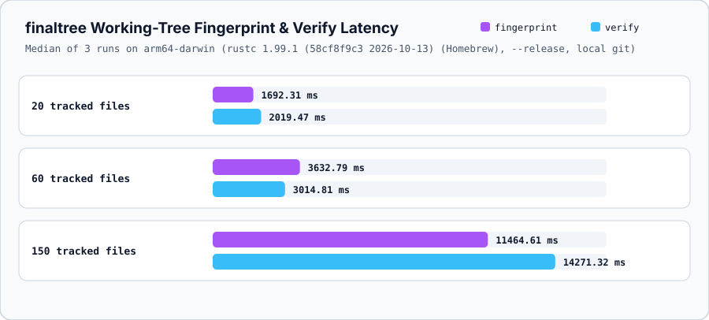

# Finaltree Performance and Footprint

Finaltree delegates blob hashing and index inspection to local `git` plumbing (`rev-parse`, `status`, `ls-files`, and `hash-object`) so working-tree digests match Git's exact object framing and `.gitattributes` filter semantics without bundling `libgit2` or OpenSSL.

<p align="center">
  <picture>
    <source media="(prefers-color-scheme: dark)" srcset="https://raw.githubusercontent.com/david-engelmann/finaltree/main/docs/media/benchmark-chart-dark.svg">
    
  </picture>
</p>

## Measured Synthetic Benchmarks

Measured over three timed iterations (after warm-up) on `arm64-darwin` with `rustc 1.99.1 (58cf8f9c3 2026-10-13) (Homebrew)` against the `--release` `finaltree` binary on clean synthetic Git repositories.

| Synthetic working tree | `finaltree fingerprint` median | `finaltree verify` median |
| --- | ---: | ---: |
| `20` tracked files | `1692.31 ms` | `2019.47 ms` |
| `60` tracked files | `3632.79 ms` | `3014.81 ms` |
| `150` tracked files | `11464.61 ms` | `14271.32 ms` |

## Operational Tuning for Fast Fingerprints

- **Keep build and virtual-environment directories outside `ROOT`** Because Finaltree hashes tracked, untracked, `--generated`, and `.gitignore`-ignored files inside `ROOT` via `git hash-object`, leaving a `20,000`-file `target/`, `.venv/`, or `node_modules/` tree inside `ROOT` spawns thousands of child `git` processes. Direct compiler and runner scratch directories outside `ROOT` (for example `CARGO_TARGET_DIR=/tmp/gate-target` or `UV_PROJECT_ENVIRONMENT=/tmp/venv`) so `ROOT` holds only source files.
- **In-process SHA-256 sealing (`src/sha256.rs`, `src/stamping.rs`)** Stamped log line prefixing and `evidence-digest` verification run in pure in-process Rust SHA-256 at memory bandwidth.
- **Binary footprint** `1,122.5 KiB` `--release` binary (`aarch64-apple-darwin`) with `0` external Rust crate dependencies.

## Reproducing Locally

Run the self-contained synthetic benchmark harness from a repository checkout.

```sh
cargo build --release --locked
python3 scripts/bench.py --bin target/release/finaltree
```
