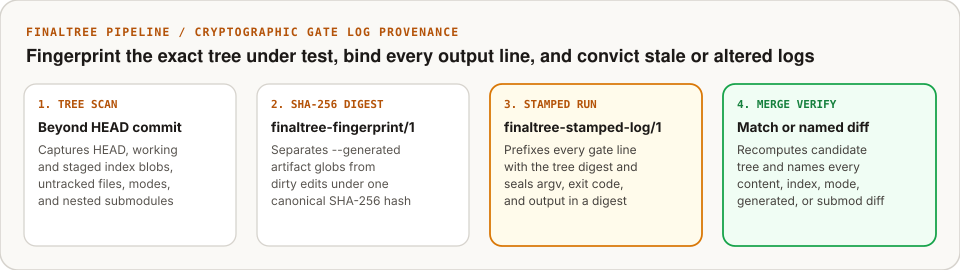
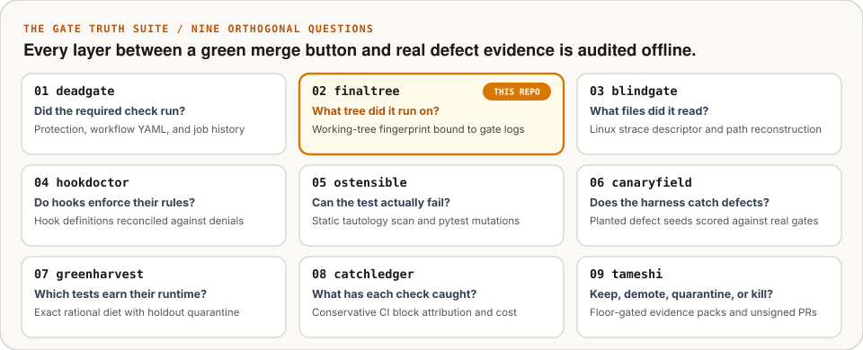

# finaltree Documentation

Finaltree asks what exact tree a gate ran on by fingerprinting `HEAD`, working-tree and staged index blobs, untracked files, executable and symlink modes, submodules, and declared generated artifacts under a canonical SHA-256 digest, stamping every output line of a gate run, and verifying stamped logs against a merge candidate.

  <picture>
    <source media="(prefers-color-scheme: dark)" srcset="https://raw.githubusercontent.com/david-engelmann/finaltree/main/docs/media/how-it-works-dark.svg">
    
  </picture>

## Handbook Contents

- [Operator Guide](GUIDE.md) Step-by-step installation, all three CLI doors, `--` command separation, external log and build-directory placement, Git hook environment hygiene, and CI workflows.
- [Architecture](ARCHITECTURE.md) Working-tree and submodule scanning, token-based glob matching, tamper-evident log sealing, and Gate Truth suite boundaries.
- [Wire Formats](FORMATS.md) Deterministic JSON and line-stamped schemas across `finaltree-fingerprint/1`, `finaltree-stamped-log/1`, and `verify` diff lines.
- [Comparison](COMPARISON.md) Technical comparison against `git rev-parse HEAD`, `git status`, CI cache keys, and sibling Gate Truth tools.
- [FAQ](FAQ.md) Direct answers to common `--log` placement, `exit-code` checking, ignored build output, and Git hook questions.
- [Changelog](../CHANGELOG.md) Release milestone summaries.
- [Security Policy](../SECURITY.md) Execution model and private vulnerability reporting.
- [Contributing](../CONTRIBUTING.md) Contract-first development rules and exact-final-head local gates.

  <picture>
    <source media="(prefers-color-scheme: dark)" srcset="https://raw.githubusercontent.com/david-engelmann/finaltree/main/docs/media/gate-truth-arc-dark.svg">
    
  </picture>

